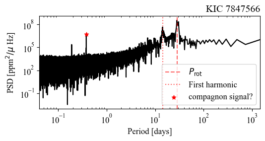
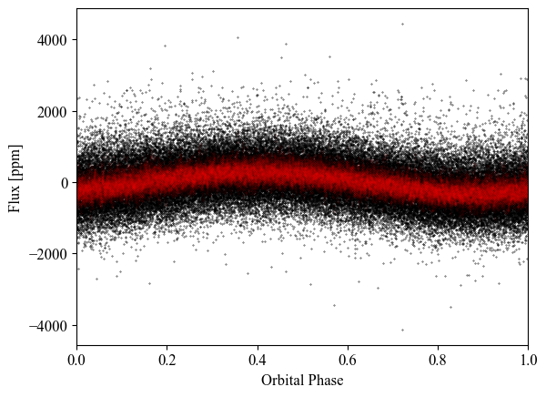
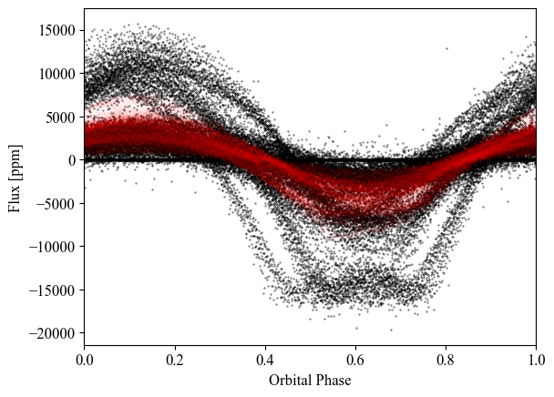
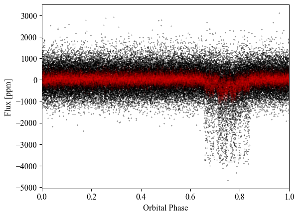

# Orbital Brightness Modulation (OBM) tutorial

**Hands-on session: spotting a non-transiting companion in a *Kepler* light curve.**
Tutorial presented during the Lorentz Center workshop: Star-Planet Interactions: Entangled Fates and Open Futures (November 2026).

A close-in companion does not need to transit to leave a mark on its star's light curve: it can induce a small, periodic brightness modulation at its orbital period. In this tutorial you will search for such a signal in the power spectral density (PSD) of *Kepler* light curves, and learn to tell it apart from stellar activity and contamination.

<p align="center">
  
  
</p>

*Left: PSD of KIC 7847566. After excluding the rotation signal, a narrow peak at 0.38 day stands out (red star). Right: folded at this period, the light curve shows a smooth, stable modulation.*

## What you will learn

1. Load *Kepler* long-cadence light curves and stellar properties.
2. Compute the PSD of a light curve.
3. Tell a **stellar-activity peak** (rotation and its harmonics) apart from a **candidate orbital signal**.
4. Measure the period of the signal and check its **stability** by phase folding.

## The four stars

| KIC | Prot (d) | Peak (d) | Folded light curve | Verdict |
|---|---|---|---|---|
| 9837312 | 4.99 | 2.5 | not folded | stellar activity (first harmonic of Prot) |
| 7847566 | 28.58 | 0.38 | smooth, stable modulation | **non-transiting companion candidate** |
| 11154093 | 10.39 | 0.26 | incoherent, changing amplitude | false positive (contamination) |
| 3351888 | 33.99 | 1.63 | sharp periodic dip | transit: the known planet **Kepler-685 b** |

<p align="center">
  
  
</p>

*Left: a counter-example, the signal is not coherent. Right: our method also recovers the known transiting planet Kepler-685 b.*

## Quick start

### 1. Download everything

Click the green **Code** button at the top of this page, then **Download ZIP**, and unzip it anywhere on your computer. The archive contains everything you need: the notebook, the helper functions and the data.

*(If you use git: `git clone https://github.com/clemencegourves/Orbital-Brightness-Modulation-tutorial.git`)*

### 2. Install the dependencies

You need Python 3.10 or later and Jupyter. In a terminal, from the unzipped folder:

```bash
# with conda
conda env create -f environment.yml
conda activate obm-tutorial

# or with pip
pip install -r requirements.txt
```

### 3. Open the notebook

```bash
jupyter lab OBM_tutorial.ipynb
```

Then run the cells from top to bottom.

## Repository content

```
Orbital-Brightness-Modulation-tutorial/
├── OBM_tutorial.ipynb          # the hands-on notebook
├── OBM_functions.py            # helper functions used by the notebook
├── Santos_stellar_data.csv     # stellar properties (rotation periods, Teff, mass, ...)
├── LightCurves/                # the four Kepler light curves (.fits)
├── images/                     # figures shown in this README
├── requirements.txt            # pip dependencies
└── environment.yml             # conda environment
```

The notebook saves its own figures in a `figures/` folder, created on the first run.

## Data

- **Light curves**: *Kepler* long-cadence data, high-pass filtered at 20 days and calibrated with the KEPSEISMIC method ([García et al., 2011](https://ui.adsabs.harvard.edu/abs/2011MNRAS.414L...6G/abstract), [2014](https://ui.adsabs.harvard.edu/abs/2014A%26A...572A..34G/abstract); [Pires et al., 2015](https://ui.adsabs.harvard.edu/abs/2015A%26A...574A..18P/abstract)).
- **Stellar properties**: ([Santos et al., 2019](https://ui.adsabs.harvard.edu/abs/2019ApJS..244...21S/abstract), [2021](https://ui.adsabs.harvard.edu/abs/2021ApJS..255...17S/abstract)), in particular the rotation periods.

## Software

This tutorial uses the Python package [apollinaire](https://apollinaire.readthedocs.io/en/latest/index.html).

## References

**Main paper**
- *Non-transiting exoplanets as a means of understanding star-planet interactions in close-in systems*, [A&A 699, A226 (2025)](https://ui.adsabs.harvard.edu/abs/2025A%26A...699A.226G/abstract)

**Data and methods**
- García et al. (2011), [MNRAS 414, L6](https://ui.adsabs.harvard.edu/abs/2011MNRAS.414L...6G/abstract)
- García et al. (2014), [A&A 572, A34](https://ui.adsabs.harvard.edu/abs/2014A%26A...572A..34G/abstract)
- Pires et al. (2015), [A&A 574, A18](https://ui.adsabs.harvard.edu/abs/2015A%26A...574A..18P/abstract)
- Santos et al. (2019), [ApJS 244, 21](https://ui.adsabs.harvard.edu/abs/2019ApJS..244...21S/abstract)
- Santos et al. (2021), [ApJS 255, 17](https://ui.adsabs.harvard.edu/abs/2021ApJS..255...17S/abstract)

**Related papers**
<!-- TODO: add authors and titles -->
- Breton et al. 2026 [A&A 712, A237 (2026)](https://ui.adsabs.harvard.edu/abs/2026A%26A...712A.237B/abstract)
- Lillo-Box et al. 2026 [arXiv:2609.20355 (2026)](https://ui.adsabs.harvard.edu/abs/2026arXiv260920355L/abstract)
- Shporer 2017 [PASP 129, 072001 (2017)](https://ui.adsabs.harvard.edu/abs/2017PASP..129g2001S/abstract)

## Contact

Questions or suggestions? Open an [issue](https://github.com/clemencegourves/Orbital-Brightness-Modulation-tutorial/issues).
